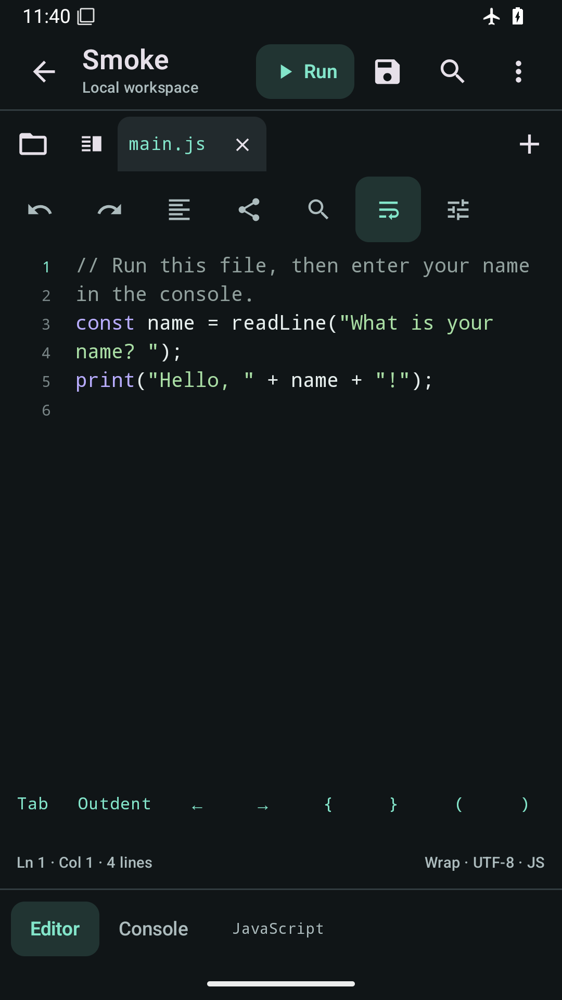

<div align="center">

# CodeLab

**A native code editor for Android.**  
Write, run, and manage projects from your phone.

[](https://github.com/iamlxwis/CodeLab/releases/latest)


[](https://github.com/iamlxwis/CodeLab/actions/workflows/android.yml)
[](https://github.com/iamlxwis/CodeLab/actions/workflows/device.yml)

**[Download APK](https://github.com/iamlxwis/CodeLab/releases/latest/download/CodeLab.apk)** · [Releases](https://github.com/iamlxwis/CodeLab/releases) · [Issues](https://github.com/iamlxwis/CodeLab/issues)

</div>

<p align="center">
  
  &nbsp;&nbsp;
  
</p>
<p align="center"><sub>Actual Android emulator screenshots from CodeLab's automated device tests.</sub></p>

## Development tracker

**Last source update:** Nov 24, 2026, 3:01 AM PHT · **Assistant work state: ACTIVE at last checkpoint** · **CI: independent, see live workflow links**

> **How to read this:** Timestamps show the last committed checkpoint, **not live activity or a heartbeat**. `ACTIVE` means implementation was in progress when that commit was written. `HANDED OFF` means the interactive session ended after that commit; it does **not** mean GitHub Actions stopped. A workflow can continue after a handoff. Always use the linked Actions runs for live build status. There is no background ChatGPT coding after a reply.

**Phase 1: Offline runtime modules** — management source partially implemented; Python is a genuine signed optional APK; JS/Lua/Java/SQL remain bundled. **Phase 2 is not started.**

| Checkpoint (PHT) | Work status | Substantive change or verified result | Pending and next |
| --- | --- | --- | --- |
| Nov 24, 2026, 3:01 AM PHT | **ACTIVE at checkpoint** | Phase 1 resumed. Tracker separated human coding state from asynchronous CI state. Current source and runtime architecture under review. | Add real signed language packs and independent management, test build/device behavior, then write an accurate final handoff with explicit remaining tasks. |

**Phase 1 acceptance:** signed package available for download, install/reinstall/removal through CodeLab with Android confirmation, persistent progress and storage, verified offline execution on supported Android devices; no source-project deletion or silent uploads. No unshipped engine is shown as installed. **Current count:** 1 optional signed runtime (Python); 2 bundled interpreters (JavaScript/Lua) slated for independent module migration; compiler-pack feasibility and acceptance pending.

[Live APK build](https://github.com/iamlxwis/CodeLab/actions/workflows/android.yml) · [Live Android devices](https://github.com/iamlxwis/CodeLab/actions/workflows/device.yml) · [Full progress audit](docs/development/PROGRESS_LOG.md) · [Implementation inventory](docs/IMPLEMENTATION_STATUS.md)

## Features

- **Code editor** — Syntax highlighting, tabs, autocomplete, undo/redo, search, snippets, and formatting.
- **Run offline** — JavaScript, Lua, SQL, and limited Java support, with an integrated console.
- **Language Manager** — Installed/Downloadable filtering, signed optional Python APK download, progress/cancel/retry, network policy, cache controls, Android-approved installation and removal.
- **Web preview** — Build and preview HTML, CSS, and JavaScript locally.
- **Projects** — Templates, autosave, file management, and ZIP import/export.
- **Tools** — Selective Git commits, optional GitHub remote sync, JavaScript debugging and code screenshots.
- **Privacy** — Optional cloud and GitHub credentials are encrypted in Android Keystore. No source upload without an explicit action.

## Optional GitHub sync

From a project, open **Git**, then expand **GitHub sync** and configure an `owner/repository` origin. **Fetch** only downloads remote history. **Pull** requires a clean working tree and only fast-forwards. **Push** requires confirmation, a GitHub access token and a clean branch; it never forces changes. Save a fine-grained token with only the repository permissions you need.

## Install

Download **[CodeLab.apk](https://github.com/iamlxwis/CodeLab/releases/latest/download/CodeLab.apk)** on an Android 8.0+ device and open it. Allow installation from your browser or file manager if prompted.

> **Before updating:** The permanent production signer was verified in [CI 45205309835](https://github.com/iamlxwis/CodeLab/actions/runs/45205309835), with actual APK certificate SHA-256 `c81d2aa1…c9e42392`. Earlier APKs were signed by rotating Android Debug certificates despite incorrect metadata. Back up and export projects before the **one-time reinstall** needed to move from a debug-signed version. Same-key in-place upgrade **passed** on Android 13 and 15 emulators; physical-phone validation remains pending. Export projects before reinstalling. Java is an interpreter-backed beta; other languages may require an optional online compiler.

## Build

Requires JDK 17 and Android SDK 35.

```bash
./gradlew :app:assembleRelease :app:testDebugUnitTest
```

[Implementation status](docs/IMPLEMENTATION_STATUS.md) · [Architecture](docs/ARCHITECTURE.md) · [Contributing](CONTRIBUTING.md) · [QA](docs/QA_CHECKLIST.md) · [Android CI](https://github.com/iamlxwis/CodeLab/actions/workflows/android.yml)

---
<sub>CodeLab keeps local projects on your device. Online execution only sends source code when you explicitly approve a cloud run.</sub>
