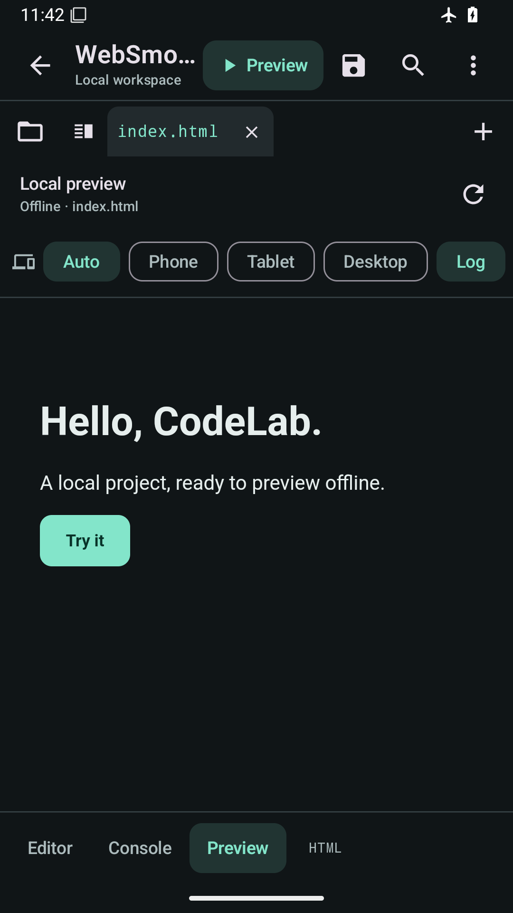

<div align="center">

# CodeLab

**A native code editor for Android.**  
Write, run, and manage projects from your phone.

[](https://github.com/iamlxwis/CodeLab/releases/latest)


[](https://github.com/iamlxwis/CodeLab/actions/workflows/android.yml)
[](https://github.com/iamlxwis/CodeLab/actions/workflows/device.yml)

**[Download APK](https://github.com/iamlxwis/CodeLab/releases/latest/download/CodeLab.apk)** · [Releases](https://github.com/iamlxwis/CodeLab/releases) · [Issues](https://github.com/iamlxwis/CodeLab/issues)

</div>

<p align="center">
  
  &nbsp;&nbsp;
  
</p>
<p align="center"><sub>Actual Android emulator screenshots from CodeLab's automated device tests.</sub></p>

## Development tracker

**Last committed checkpoint:** Nov 24, 2026, 3:18 AM PHT · **Assistant: HANDED OFF after this checkpoint** · **CI: check live Actions, not this timestamp**

**Read this first:** This tracker is a **commit log, not a live timer**. A checkpoint timestamp is when the README was last committed. `HANDOFF` means the assistant's current interactive turn ended; GitHub Actions may still run independently. A new chat can resume work from this checkpoint. No automatic assistant work is promised between messages.

| Scope | Done / current state | Still required |
| --- | --- | --- |
| **CI Option B — Smart CI** | **Implemented:** source/build/QA/workflow-only triggers, docs-only commits skipped; fast Gradle build/unit/lint/security; manual API 35 device smoke; `cancel-in-progress: true`; explicit manual release publication after same-commit device gate | Confirm current CI build and Android 15 manual smoke; release only after gate |
| **Phase 1 — Offline modules** | Python optional signed APK already published; JavaScript and Lua companion APK source, isolated services and signing/artifact pipeline added; bundled JS/Lua/Java/SQL preserved | **JS/Lua module downloader, authenticated execution routing, install/reinstall/removal UI, real device tests; TypeScript/native compiler toolchains not packaged** |
| **Phase 2 — Editor** | Not started | Begin only when agreed Phase 1 acceptance is met |

**Progress:** CI workflow optimization **implemented (verification pending)**. Release gate fixed to recognize manually dispatched device smoke (a7c5b5af); offscreen emulator assertion replaced with visible summary (bc9fc2b9). Phase 1 **partial, not complete**. **Current workstream:** JavaScript/Lua companion packaging, Android 15 QA and downloader/execution integration. **Latest source:** [bc9fc2b9](https://github.com/iamlxwis/CodeLab/commit/bc9fc2b99f4c0e44a1fe4b9ed088352e6487e95e). **Latest fast CI:** [45247505643](https://github.com/iamlxwis/CodeLab/actions/runs/45247505643) queued at checkpoint; earlier runs were cancelled by newer commits as configured. **Next action:** inspect [fast CI run](https://github.com/iamlxwis/CodeLab/actions/workflows/android.yml), correct compiler issues, then integrate module discovery/downloading/execution; manually run [API 35 smoke](https://github.com/iamlxwis/CodeLab/actions/workflows/device.yml) at the release checkpoint.

**CI policy:** Every meaningful source push gets one fast build; documentation-only commits do not trigger Android CI. Device smoke is manual on Android 15 only. Public `latest` release is updated **only** by a manual `Android APK` workflow dispatch with `publish_release=true`, after same-commit device smoke succeeds. Superseded workflow runs are cancelled.

[Full audit](docs/development/PROGRESS_LOG.md) · [Project memory](docs/development/PROJECT_MEMORY.md) · [Implementation inventory](docs/IMPLEMENTATION_STATUS.md)

## Features

- **Code editor** — Syntax highlighting, tabs, autocomplete, undo/redo, search, snippets, and formatting.
- **Run offline** — JavaScript, Lua, SQL, and limited Java support, with an integrated console.
- **Language Manager** — Installed/Downloadable filtering, signed optional Python APK download, progress/cancel/retry, network policy, cache controls, Android-approved installation and removal.
- **Web preview** — Build and preview HTML, CSS, and JavaScript locally.
- **Projects** — Templates, autosave, file management, and ZIP import/export.
- **Tools** — Selective Git commits, optional GitHub remote sync, JavaScript debugging and code screenshots.
- **Privacy** — Optional cloud and GitHub credentials are encrypted in Android Keystore. No source upload without an explicit action.

## Optional GitHub sync

From a project, open **Git**, then expand **GitHub sync** and configure an `owner/repository` origin. **Fetch** only downloads remote history. **Pull** requires a clean working tree and only fast-forwards. **Push** requires confirmation, a GitHub access token and a clean branch; it never forces changes. Save a fine-grained token with only the repository permissions you need.

## Install

Download **[CodeLab.apk](https://github.com/iamlxwis/CodeLab/releases/latest/download/CodeLab.apk)** on an Android 8.0+ device and open it. Allow installation from your browser or file manager if prompted.

> **Before updating:** The permanent production signer was verified in [CI 45205309835](https://github.com/iamlxwis/CodeLab/actions/runs/45205309835), with actual APK certificate SHA-256 `c81d2aa1…c9e42392`. Earlier APKs were signed by rotating Android Debug certificates despite incorrect metadata. Back up and export projects before the **one-time reinstall** needed to move from a debug-signed version. Same-key in-place upgrade **passed** on Android 13 and 15 emulators; physical-phone validation remains pending. Export projects before reinstalling. Java is an interpreter-backed beta; other languages may require an optional online compiler.

## Build

Requires JDK 17 and Android SDK 35.

```bash
./gradlew :app:assembleRelease :app:testDebugUnitTest
```

[Implementation status](docs/IMPLEMENTATION_STATUS.md) · [Architecture](docs/ARCHITECTURE.md) · [Contributing](CONTRIBUTING.md) · [QA](docs/QA_CHECKLIST.md) · [Android CI](https://github.com/iamlxwis/CodeLab/actions/workflows/android.yml)

---
<sub>CodeLab keeps local projects on your device. Online execution only sends source code when you explicitly approve a cloud run.</sub>
